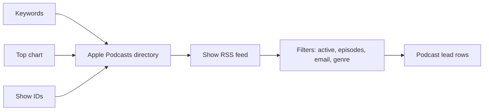

# Apple Podcasts Scraper: Podcast Leads with Host Emails, Episodes and RSS Feeds

[](https://apify.com/Turboextract/apple-podcasts-leads)
[](LICENSE)
[](#pricing)

**Find podcasts on Apple Podcasts by keyword, top chart or show ID, then get each show's owner email, website, genre, language, episode count, last episode date and RSS feed.** Built for guest booking, sponsorship sales and podcast outreach. No login or API key.

In one test, the keyword "marketing" plus the US top chart, filtered to shows active in the last 30 days, returned 8 shows in about 20 seconds, and 6 of them listed a direct owner email.

**Try it now →** [apify.com/Turboextract/apple-podcasts-leads](https://apify.com/Turboextract/apple-podcasts-leads)

---

## Why this exists

- Apple Podcasts has no export and hides host contacts.
- Owner emails sit inside each show's RSS feed, one feed at a time.
- Podcast databases charge $100 to $300 a month.
- Guest bookers and sponsors need active shows with contacts in one sheet.

---

## Who this is for

- **PR agencies and guest bookers** pitching clients as podcast guests
- **Sponsorship and ad sales teams** looking for active shows in a niche
- **Podcast services** (editing, hosting, growth) prospecting new customers
- **Brands and marketers** mapping the shows their audience listens to
- **Researchers** building podcast datasets by genre and country

---

## What you get

```json
{
  "podcastId": 1588397602,
  "title": "Marketing Happy Hour",
  "author": "Marketing Happy Hour",
  "appleUrl": "https://podcasts.apple.com/us/podcast/marketing-happy-hour/id1588397602",
  "feedUrl": "https://anchor.fm/s/50d9d294/podcast/rss",
  "primaryGenre": "Marketing",
  "genres": ["Marketing", "Business"],
  "ownerName": "Marketing Happy Hour",
  "ownerEmail": "c*****@cammmedia.com",
  "website": "https://www.marketinghappyhr.com/",
  "language": "en",
  "episodeCount": 292,
  "lastEpisodeDate": "2026-11-19T10:20:00.000Z",
  "lastEpisodeTitle": "Why Trust and Credibility Are the New Performance Marketing",
  "hosting": "Anchor Podcasts",
  "source": "search: marketing"
}
```

---

## How it works



---

## Quick start

1. Click **Try for free**.
2. Add **Search keywords**, like `true crime` or `b2b sales`.
3. Optional: turn on **Include the top chart**, or paste **Podcast IDs or URLs**.
4. Optional: set **Active within days**, **Only shows with an email** or **Genre contains**.
5. Click **Start**, then export to CSV, JSON, Excel or Google Sheets.

### API

```bash
curl -X POST "https://api.apify.com/v2/acts/Turboextract~apple-podcasts-leads/run-sync-get-dataset-items?token=YOUR_TOKEN" \
  -H "Content-Type: application/json" \
  -d '{"searchTerms": ["saas", "startup"], "activeWithinDays": 30, "onlyWithEmail": true}'
```

### Python

```python
from apify_client import ApifyClient

client = ApifyClient("YOUR_TOKEN")
run = client.actor("Turboextract/apple-podcasts-leads").call(run_input={
    "searchTerms": ["fitness"],
    "country": "gb",
    "minEpisodes": 20,
    "maxResults": 200,
})
for show in client.dataset(run["defaultDatasetId"]).iterate_items():
    print(show["title"], show["ownerEmail"], show["lastEpisodeDate"])
```

---

## Input fields

| Field | Default | What it does |
|---|---|---|
| `searchTerms` | – | Keywords; up to 200 shows each |
| `topCharts` | false | Adds the top 100 shows for the country |
| `podcastIds` | – | Apple Podcasts IDs or show links |
| `country` | us | Store country |
| `includeFeed` | true | Reads the RSS feed for email, website and episodes |
| `onlyWithEmail` | false | Skip shows with no owner email |
| `activeWithinDays` | 0 | Skip shows with no recent episode |
| `minEpisodes` | 0 | Skip young shows |
| `genre` | – | Keep only matching genres |
| `maxResults` | 50 | Total cap per run |

---

## Pricing

**$0.002 per podcast delivered, contacts included.** 1,000 podcasts cost $2.

| Option | 1,000 podcasts |
|---|---|
| **Apple Podcasts Scraper** | **$2**, owner emails included |
| Podcast database subscriptions | $100 to $300 a month |

---

## Common use cases

- **Guest booking**: active business shows with 50+ episodes and an owner email
- **Sponsorship sales**: shows in your niche that published this month
- **Agency prospecting**: shows on a given host, using the `hosting` field
- **Chart tracking**: schedule the top chart daily and watch who climbs
- **Market research**: count shows and activity by genre and country

---

## Tips for best results

- The show ID is the number after `id` in a podcasts.apple.com link.
- `ownerEmail` comes from the show's own RSS feed. `otherEmails` lists extra addresses found in the show description.
- `episodeCount` counts episodes in the feed. Some hosts trim old episodes from feeds.
- Use several narrow keywords instead of one broad one for bigger lists.

---

## Pairs well with

- [Podcast Transcript to AI Dataset](https://apify.com/Turboextract/podcast-transcript-dataset): every episode transcript from a show's feed
- [YouTube Scraper](https://apify.com/Turboextract/youtube-videos-scraper): video podcasts and their channel stats
- [B2B Lead Enrichment Pipeline](https://apify.com/Turboextract/b2b-lead-enrichment-pipeline): enrich the show websites with company data

---

## FAQ

**Do I need an Apple account?** No. The actor uses Apple's public podcast directory and each show's public RSS feed.

**Why is the email empty for some shows?** Some hosts hide the owner email from the feed.

**Does it include Spotify-only shows?** No, only shows listed on Apple Podcasts. Most shows are on both.

**How fresh is the data?** It is read live on every run.

**Is it legal?** It reads public directory data and the RSS feeds podcasters publish so apps can list their shows. Follow anti-spam rules when you email.

---

## SEO keywords

Apple Podcasts scraper, podcast email finder, podcast leads, podcast guest booking list, podcast host contact, podcast RSS scraper, iTunes podcast API, podcast sponsorship prospecting, podcast database export, top podcasts chart data

---

## Support

- Actor page: https://apify.com/Turboextract/apple-podcasts-leads
- Issues and questions: open an issue in this repo
- Community Discord: https://discord.gg/8SrXSCpvgj

Built and maintained by [Turboextract](https://apify.com/Turboextract) on the Apify platform.

---

## License

The documentation and examples in this repository are MIT licensed. The actor itself runs on the Apify platform.
